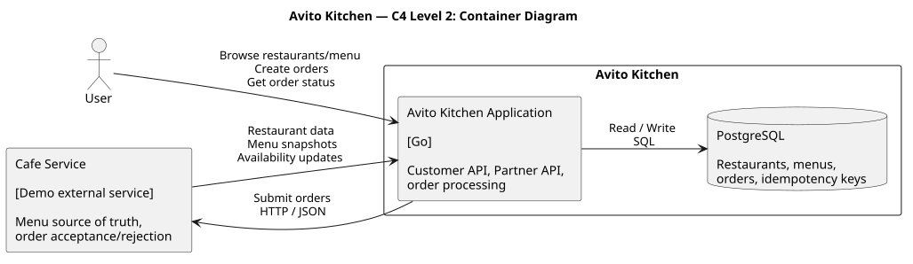
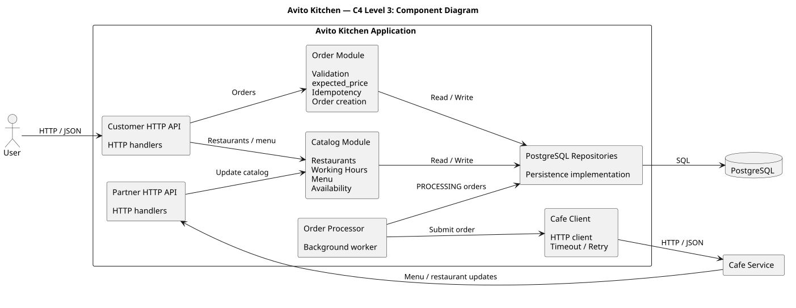

# Avito Kitchen

MVP backend-сервиса для сценария заказа еды через Авито.Кухню.

Проект состоит из основного сервиса **Avito Kitchen**, PostgreSQL и демонстрационного внешнего сервиса **Demo Cafe**. Заведение синхронизирует с Avito Kitchen данные о себе и меню, пользователь создаёт заказ через Customer API, после чего Avito Kitchen асинхронно передаёт заказ в Demo Cafe и сохраняет финальный результат обработки.

## Что реализовано

### Customer API

- получение доступных заведений;
- получение меню заведения;
- создание заказа;
- получение текущего состояния заказа.

### Partner API

- регистрация заведения;
- обновление данных заведения и расписания;
- полная синхронизация menu snapshot;
- обновление оперативного количества товара.

### Обработка заказов

- серверная проверка актуальной цены через `expected_price`;
- повторная проверка доступности заведения и товаров перед созданием заказа;
- идемпотентное создание заказа по `Idempotency-Key`;
- сохранение заказа в `PROCESSING` до сетевого взаимодействия с заведением;
- фоновая доставка заказов в Cafe Service;
- retry при технических ошибках;
- разделение business rejection и technical failure;
- идемпотентная обработка повторной доставки заказа в Demo Cafe;
- финальные состояния `ACCEPTED` и `REJECTED`.

## Стек

- Go 1.25;
- PostgreSQL 17;
- `pgx/v5`;
- стандартный `net/http`;
- Docker Compose;
- golangci-lint;
- OpenAPI 3.0.3.

В проект намеренно не добавлялись брокер сообщений, Redis, Kubernetes и web-framework: для данного MVP они не нужны для демонстрации выбранных бизнес-сценариев и архитектурных решений.

## Быстрый запуск

Из корня репозитория:

```bash
docker compose up --build -d
```

Docker Compose поднимает:

- PostgreSQL;
- контейнер миграций;
- Avito Kitchen на `http://localhost:8080`;
- Demo Cafe на `http://localhost:8081`.

Проверка:

```text
GET http://localhost:8080/health/live
GET http://localhost:8080/health/ready
GET http://localhost:8081/health/live
```

Остановка:

```bash
docker compose down
```

Полный сброс локальной БД:

```bash
docker compose down -v
```

Подробный ручной flow и команды тестирования находятся в [`TESTING.md`](TESTING.md).

## API

Полные контракты находятся в OpenAPI:

- [`api/avito-kitchen.openapi.yaml`](api/avito-kitchen.openapi.yaml);
- [`api/demo-cafe.openapi.yaml`](api/demo-cafe.openapi.yaml).

Основные endpoint'ы Avito Kitchen:

| Method | Endpoint | Назначение |
|---|---|---|
| `GET` | `/health/live` | liveness |
| `GET` | `/health/ready` | readiness PostgreSQL |
| `GET` | `/api/v1/restaurants` | доступные заведения |
| `GET` | `/api/v1/restaurants/{restaurant_id}/menu` | актуальное меню |
| `POST` | `/api/v1/orders` | создание заказа |
| `GET` | `/api/v1/orders/{order_id}` | состояние заказа |
| `POST` | `/api/v1/partner/restaurants` | регистрация заведения |
| `PATCH` | `/api/v1/partner/restaurants/{restaurant_id}` | обновление заведения |
| `PUT` | `/api/v1/partner/restaurants/{restaurant_id}/menu` | полный menu snapshot |
| `PATCH` | `/api/v1/partner/restaurants/{restaurant_id}/menu-items/{external_item_id}/availability` | изменение количества |

Demo Cafe предоставляет:

| Method | Endpoint | Назначение |
|---|---|---|
| `GET` | `/health/live` | liveness |
| `POST` | `/api/v1/orders` | финальная обработка заказа заведением |

Авторизация и аутентификация намеренно не входят в MVP. Поэтому `user_id` передаётся в запросе создания заказа как внешний идентификатор пользователя Avito.

# Архитектура

Avito Kitchen реализован как **modular monolith**. Demo Cafe — отдельный сервис, который не импортирует код Avito Kitchen и взаимодействует с ним только по HTTP.

## C4 Level 2 — Containers



Основные контейнеры:

- **Avito Kitchen Application** — HTTP API, бизнес-логика и background order processor;
- **PostgreSQL** — каталог, заказы и idempotency state;
- **Demo Cafe Service** — пример внешнего заведения и финальный source of truth при обработке заказа.

Avito Kitchen обслуживает пользовательское чтение из собственной локальной БД и не обращается к Cafe Service при каждом запросе меню. Cafe Service синхронизирует каталог через Partner API, а к своему API обращение получает только при обработке заказа.

## C4 Level 3 — Components



Внутри Avito Kitchen выделены следующие логические компоненты:

- Customer HTTP API;
- Partner HTTP API;
- Restaurant/Menu services;
- Order service;
- PostgreSQL repositories;
- Cafe HTTP client;
- background Order Processor.

HTTP handlers отвечают только за transport-layer. Основные бизнес-правила находятся в service layer, а PostgreSQL-specific логика — в repositories.

# Основной flow заказа

```text
Cafe Service
    |
    | синхронизация restaurant/menu/availability
    v
Avito Kitchen + PostgreSQL
    |
    | GET restaurants / GET menu
    v
User
    |
    | POST /orders + Idempotency-Key
    v
Avito Kitchen
    |
    | атомарно создаёт PROCESSING order + order_items
    v
PostgreSQL
    |
    | background polling
    v
Order Processor
    |
    | POST restaurant.order_endpoint
    v
Demo Cafe
    |
    | ACCEPTED / REJECTED
    v
Avito Kitchen
    |
    | сохраняет финальное состояние
    v
GET /orders/{id}
```

Внешний HTTP-вызов в Cafe Service **не выполняется внутри database transaction**. Заказ сначала сохраняется, и только после commit становится доступен background processor'у.

При временной сетевой ошибке или HTTP 5xx заказ остаётся `PROCESSING` и будет обработан повторно. Повторная доставка безопасна благодаря `avito_order_id`, который Demo Cafe использует как idempotency key.

# Ключевые проектные решения

## Локальный каталог в Avito Kitchen

Cafe Service является источником данных о собственном меню, но Avito Kitchen хранит синхронизированную локальную копию. Это позволяет не делать внешний HTTP-запрос на каждый пользовательский просмотр каталога.

Данные, важные для write-operation, повторно проверяются при создании заказа.

## Полный menu snapshot

```text
PUT /api/v1/partner/restaurants/{restaurant_id}/menu
```

передаёт **полное актуальное состояние меню**, а не частичный patch.

Snapshot применяется атомарно:

1. блокируется строка `menus`;
2. проверяется `snapshot_version`;
3. отсутствующие элементы деактивируются;
4. переданные элементы создаются или обновляются;
5. обновляется версия snapshot;
6. transaction commit.

Правила версии:

- `incoming > current` — применить snapshot;
- `incoming == current` — безопасный retry;
- `incoming < current` — `STALE_SNAPSHOT_UPDATE`.

Оперативное изменение `available_quantity` не увеличивает `snapshot_version`.

## Цена заказа

Клиент передаёт `expected_price` — цену, которую видел и подтвердил пользователь.

Сервер сравнивает её с текущей ценой из БД. Если цена успела измениться, заказ не создаётся и возвращается `PRICE_CHANGED`. Клиентская цена никогда не используется как source of truth.

Деньги хранятся целыми числами в минимальных денежных единицах (`BIGINT`), без `float`.

## Исторический snapshot заказа

`order_items` хранит собственные:

- `external_menu_item_id`;
- `name`;
- `unit_price`;
- `quantity`.

Поэтому последующее изменение или деактивация позиции меню не изменяет исторический заказ.

## Идемпотентность

Создание заказа требует заголовок:

```text
Idempotency-Key
```

Для ключа сохраняется hash нормализованного запроса:

- тот же ключ + тот же запрос → возвращается существующий заказ;
- тот же ключ + другой запрос → `IDEMPOTENCY_KEY_REUSED`.

Связка idempotency key, `orders` и `order_items` создаётся атомарно.

## Business rejection и technical failure

Отказ Cafe Service выполнить корректно доставленный заказ является бизнес-результатом:

- `OUT_OF_STOCK`;
- `ITEM_UNAVAILABLE`;
- `NOT_ACCEPTING_ORDERS`;
- `STALE_MENU_SNAPSHOT`.

Он переводит заказ в `REJECTED`.

Сетевой timeout, connection error, HTTP 5xx или некорректный ответ Cafe — техническая ошибка. Заказ остаётся `PROCESSING` и будет повторно доставлен.

# Схема БД


Схема создаётся миграциями из [`services/avito-kitchen/migrations`](services/avito-kitchen/migrations).

Основные таблицы:

| Таблица | Назначение |
|---|---|
| `restaurants` | локальная запись заведения и связь с его external ID |
| `restaurant_working_hours` | недельное расписание заведения |
| `menus` | меню заведения и `snapshot_version` |
| `menu_items` | локальный каталог, цены, количество, active flag |
| `orders` | состояние заказа внутри Avito Kitchen |
| `order_items` | immutable snapshot заказанных позиций |
| `idempotency_keys` | состояние идемпотентности create-order |

Ключевые DB-инварианты дополнительно защищены через `PRIMARY KEY`, `FOREIGN KEY`, `UNIQUE`, `NOT NULL` и `CHECK` constraints.

Пользователь не хранится отдельной локальной сущностью: `orders.user_id` — внешний идентификатор пользователя Avito. Avito Kitchen не отвечает за lifecycle пользователя.

# CJM и бизнес-сценарии

Подробное описание сценариев находится в [`docs/design/business-scenarios.md`](docs/design/business-scenarios.md).

Code-generated диаграммы сценариев:

- [просмотр заведений и меню](docs/diagrams/browse-restaurants-and-menu.svg);
- [успешное создание заказа](docs/diagrams/create-order-success.svg);
- [изменение цены](docs/diagrams/price-changed.svg);
- [товар закончился](docs/diagrams/item-out-of-stock.svg);
- [заведение перестало принимать заказы](docs/diagrams/restaurant-unavailable.svg);
- [Cafe Service отклоняет заказ](docs/diagrams/cafe-rejects-order.svg);
- [Cafe Service обновляет меню](docs/diagrams/update-menu.svg).

Дополнительно в репозитории находятся диаграммы транзакций:

- [создание заказа](docs/diagrams/create-order-transaction.svg);
- [обновление menu snapshot](docs/diagrams/menu-snapshot-transaction.svg).

# Структура репозитория

```text
.
├── api/                         # OpenAPI
├── docs/
│   ├── design/                  # принятые бизнес- и архитектурные решения
│   └── diagrams/                # C4, ER и sequence diagrams
├── services/
│   ├── avito-kitchen/           # основной сервис
│   │   ├── cmd/api/
│   │   ├── internal/
│   │   └── migrations/
│   └── demo-cafe/               # демонстрационное заведение
├── docker-compose.yml
├── go.work
└── TESTING.md
```

Подробные design-документы:

- [`docs/design/scopes-and-responsibilities.md`](docs/design/scopes-and-responsibilities.md);
- [`docs/design/business-scenarios.md`](docs/design/business-scenarios.md);
- [`docs/design/api-design.md`](docs/design/api-design.md);
- [`docs/design/data-model.md`](docs/design/data-model.md).

# Тестирование и качество

Avito Kitchen:

```bash
cd services/avito-kitchen
go test ./...
go vet ./...
golangci-lint run ./...
```

Integration tests с PostgreSQL:

```bash
docker compose up -d postgres migrate

cd services/avito-kitchen
go test -tags=integration -p 1 ./...
```

Demo Cafe:

```bash
cd services/demo-cafe
go test ./...
go vet ./...
golangci-lint run ./...
```

`-p 1` используется для integration suite, потому что PostgreSQL integration tests работают с общей локальной тестовой БД и не должны запускаться пакетами параллельно.

Полный ручной E2E сценарий описан в [`TESTING.md`](TESTING.md).

# Осознанные ограничения MVP

В рамках тестового задания намеренно оставлены следующие упрощения:

- нет authentication/authorization;
- нет реальной оплаты;
- нет доставки и логистики;
- нет frontend-клиента;
- нет резервирования stock внутри Avito Kitchen;
- одно заведение имеет одно меню;
- одно расписание содержит максимум один интервал на день;
- интервалы, переходящие через полночь, не поддерживаются;
- нет праздничного календаря;
- Demo Cafe хранит своё демонстрационное состояние и idempotency state в памяти;
- background processor использует PostgreSQL polling вместо message broker;
- при горизонтальном масштабировании несколько worker'ов могут попытаться доставить один `PROCESSING` order одновременно; корректность сохраняется за счёт idempotency Cafe, но production-версия потребовала бы claim/lease механизма (`FOR UPDATE SKIP LOCKED`, отдельного delivery state или очереди);
- `order_endpoint` считается доверенной частью закрытого Partner API; в публичной системе потребовались бы дополнительные SSRF-защиты/allowlist;
- retry выполняется с фиксированной частотой без exponential backoff и dead-letter механизма.

Эти ограничения выбраны сознательно, чтобы сохранить решение простым и сфокусированным на бизнес-сценариях MVP.

# Возможное развитие

При развитии MVP можно добавить:

- authentication и partner authorization;
- persistent outbox / broker для доставки заказов;
- claim/lease для параллельных workers;
- backoff и ограничение числа retry;
- полноценную синхронизацию состояния Demo Cafe;
- payment lifecycle;
- отдельные профили пользователей;
- observability: metrics, tracing, structured correlation IDs.

# Использование ИИ

ИИ использовался как помощник при проектировании, code review и реализации отдельных частей. Архитектурные решения сначала фиксировались в `docs/design`, после чего реализация выполнялась небольшими vertical slices: bootstrap → restaurant → menu → order persistence → Demo Cafe → background processing → проверка end-to-end flow.

Ответственность за выбранные решения, итоговый код и возможность объяснить их остаётся за автором проекта.
