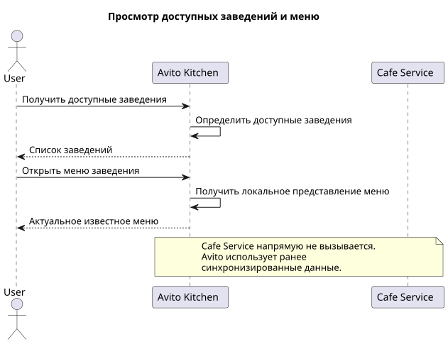
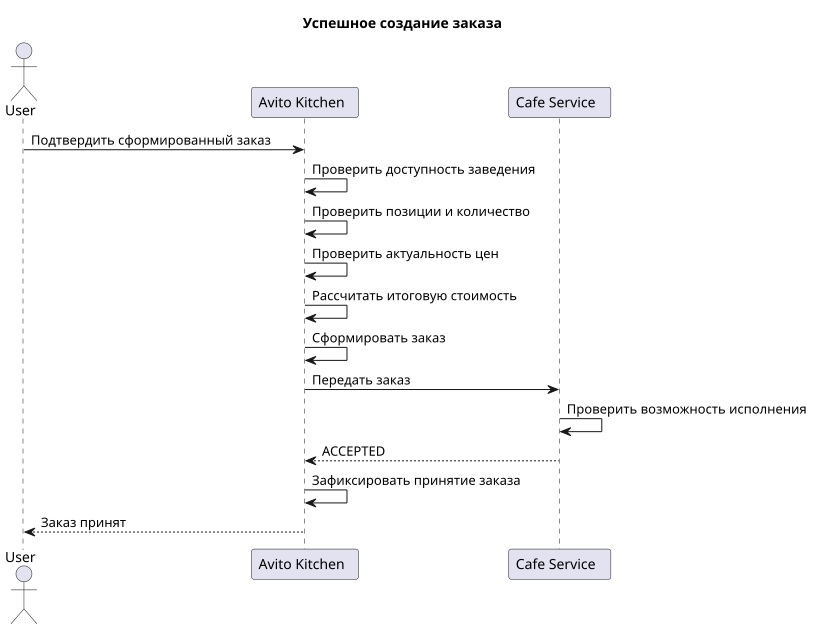
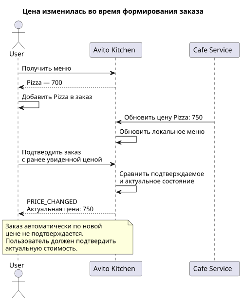
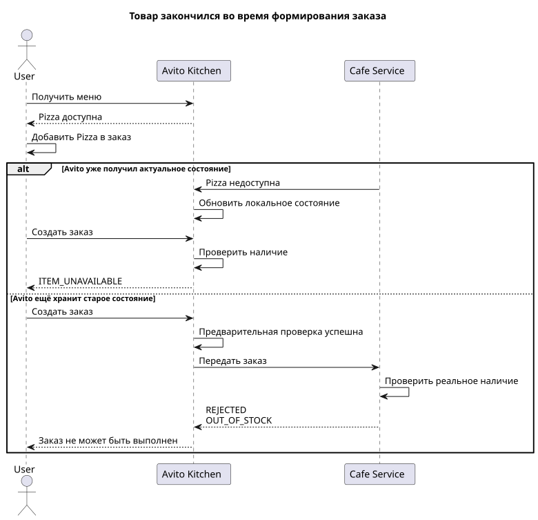
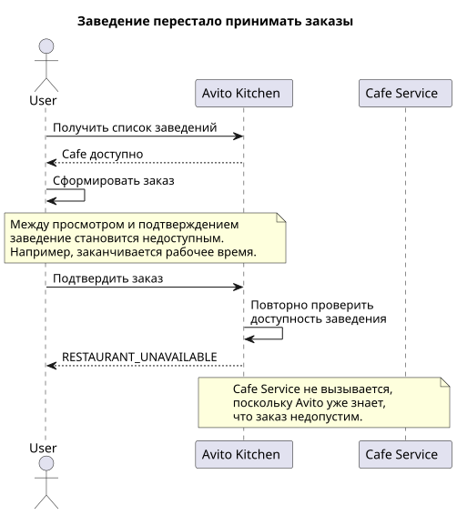
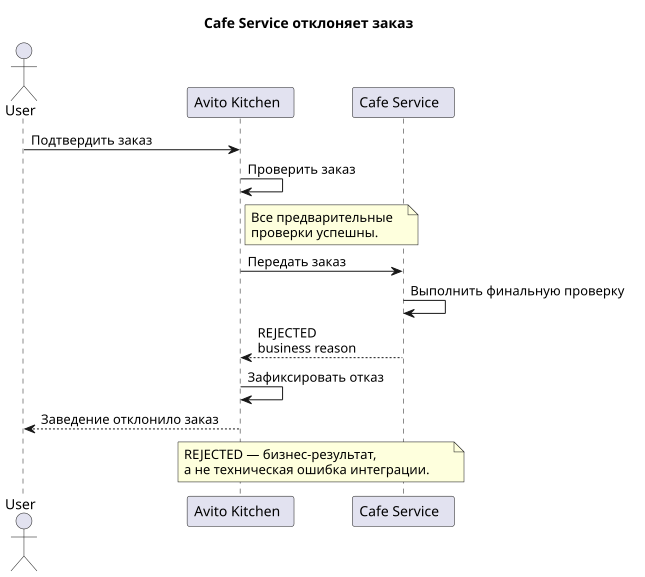
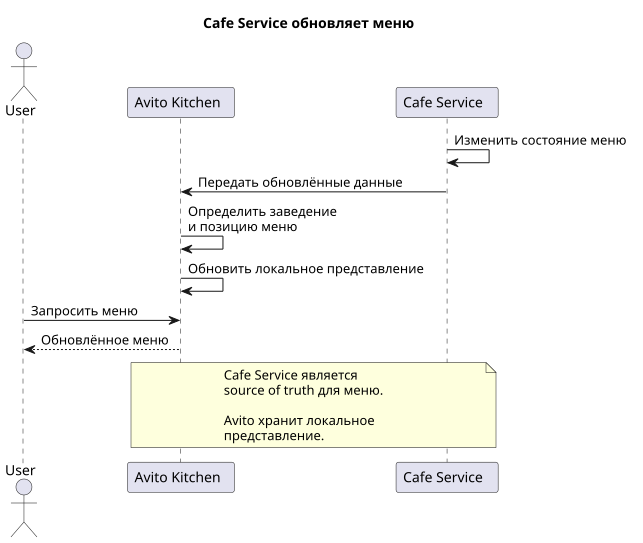

# Business Scenarios

## 1. Назначение документа

Документ описывает основные бизнес-сценарии MVP **Avito Kitchen** со стороны пользователя и заведения.

Сценарии используются для:

* уточнения поведения системы;
* определения основных и альтернативных пользовательских путей;
* выявления изменений состояния между чтением данных и созданием заказа;
* формирования бизнес-правил;
* дальнейшего проектирования API;
* дальнейшего проектирования модели данных;
* формирования C4-модели системы.

На данном этапе намеренно не фиксируются конкретные HTTP endpoints, структура запросов, таблицы базы данных и детали реализации.

Для описания взаимодействия используются три основных участника:

* **User** — пользователь Avito Kitchen;
* **Avito Kitchen** — основная система;
* **Cafe Service** — информационная система заведения.

---

# 2. Общие бизнес-правила

Перед рассмотрением отдельных сценариев фиксируются несколько правил, применимых ко всей системе.

## 2.1. Просмотр данных не резервирует их состояние

Получение пользователем информации о заведении или меню не гарантирует, что это состояние сохранится до момента создания заказа.

Например, пользователь мог увидеть:

```text
Restaurant = AVAILABLE
Pizza price = 700
Pizza available_quantity = 3
```

Однако до момента создания заказа:

* заведение может перестать принимать заказы;
* цена товара может измениться;
* товар может закончиться;
* позиция может быть удалена или отключена.

Поэтому значимые данные должны повторно проверяться в момент создания заказа.

---

## 2.2. Клиент не является источником истины

Данные, переданные пользователем, используются для выражения его намерения, но не считаются доверенными.

Пользователь может выбрать:

* заведение;
* позиции;
* количество позиций.

Однако Avito Kitchen самостоятельно определяет:

* актуальную цену;
* доступность заведения;
* актуальное состояние позиции;
* итоговую стоимость;
* возможность сформировать заказ.

---

## 2.3. Cafe Service является источником данных о заведении

Cafe Service является первичным источником данных о:

* заведении;
* графике его работы;
* меню;
* ценах;
* наличии товаров.

Avito Kitchen хранит локальное синхронизированное представление этих данных.

---

## 2.4. Финальное подтверждение возможности выполнения заказа остаётся за Cafe Service

Avito Kitchen выполняет предварительную проверку заказа на основании собственного актуального состояния.

Однако между синхронизацией данных и созданием заказа состояние Cafe Service может измениться.

Поэтому Cafe Service выполняет финальную проверку возможности исполнения заказа и может:

* принять заказ;
* отклонить заказ.

---

# 3. Сценарий 1 — Просмотр доступных заведений и меню

## Цель

Пользователь хочет найти доступное для заказа заведение и ознакомиться с его меню.

## Участники

* User;
* Avito Kitchen.

Cafe Service напрямую в пользовательском запросе не участвует, поскольку Avito Kitchen использует локально синхронизированное представление каталога.

## Предусловия

* в Avito Kitchen зарегистрировано хотя бы одно заведение;
* Cafe Service ранее передал информацию о заведении;
* Cafe Service ранее синхронизировал меню;
* заведение доступно для оформления заказа.

## Основной сценарий

1. Пользователь запрашивает список заведений.
2. Avito Kitchen определяет заведения, доступные для заказа в текущий момент.
3. Avito Kitchen возвращает список доступных заведений.
4. Пользователь выбирает одно из заведений.
5. Пользователь запрашивает его меню.
6. Avito Kitchen получает локальное представление меню.
7. Пользователю возвращаются доступные позиции меню и информация о них.

## Результат

Пользователь получает список заведений и может ознакомиться с меню выбранного заведения.

## Бизнес-правила

* пользователь не взаимодействует с Cafe Service напрямую;
* недоступное заведение не должно считаться доступным для оформления заказа;
* просмотр заведения не гарантирует, что оно останется доступным до момента создания заказа;
* просмотр меню не резервирует цену или наличие товара;
* пользовательские read-запросы не должны требовать обращения к Cafe Service.

## Диаграмма




---

# 4. Сценарий 2 — Успешное создание заказа

## Цель

Пользователь хочет оформить заказ из выбранных позиций меню.

## Участники

* User;
* Avito Kitchen;
* Cafe Service.

## Предусловия

* пользователь выбрал заведение;
* пользователь выбрал хотя бы одну позицию;
* выбранное заведение существует;
* заведение принимает заказы;
* выбранные товары доступны;
* данные меню не изменились относительно состояния, подтверждаемого пользователем;
* Cafe Service способен выполнить заказ.

## Основной сценарий

1. Пользователь формирует заказ из выбранных позиций и их количества.
2. Пользователь подтверждает заказ.
3. Avito Kitchen повторно проверяет состояние заведения.
4. Avito Kitchen проверяет существование и доступность выбранных позиций.
5. Avito Kitchen получает актуальные цены.
6. Avito Kitchen рассчитывает итоговую стоимость заказа.
7. Avito Kitchen формирует заказ внутри платформы.
8. Avito Kitchen передаёт заказ соответствующему Cafe Service.
9. Cafe Service выполняет финальную проверку возможности исполнения.
10. Cafe Service принимает заказ.
11. Avito Kitchen фиксирует успешный результат обработки.
12. Пользователь получает подтверждение принятия заказа.

## Результат

Заказ зарегистрирован в Avito Kitchen и принят заведением.

## Бизнес-правила

* итоговая стоимость рассчитывается Avito Kitchen;
* пользователь не может самостоятельно определить стоимость заказа;
* все позиции одного заказа относятся к одному заведению;
* количество каждой позиции должно быть положительным;
* состояние заведения и товаров повторно проверяется непосредственно перед созданием заказа;
* финальное решение о возможности исполнения принимает Cafe Service.

## Диаграмма




---

# 5. Сценарий 3 — Изменение цены во время формирования заказа

## Цель

Корректно обработать ситуацию, когда цена товара изменилась после просмотра меню, но до подтверждения заказа пользователем.

## Участники

* User;
* Avito Kitchen;
* Cafe Service.

## Предусловия

1. Пользователь открыл меню.
2. На момент просмотра цена товара составляла определённую сумму.
3. Пользователь добавил товар в формируемый заказ.
4. До подтверждения заказа Cafe Service изменил цену.
5. Новая цена была синхронизирована с Avito Kitchen.

Пример:

```text
T1:
Pizza = 700

Пользователь добавляет Pizza в заказ.

T2:
Cafe Service изменяет цену.

Pizza = 750

T3:
Пользователь подтверждает заказ.
```

## Основной сценарий

1. Пользователь получает меню с текущей ценой товара.
2. Пользователь начинает формировать заказ.
3. Cafe Service изменяет цену товара.
4. Cafe Service передаёт изменение Avito Kitchen.
5. Avito Kitchen обновляет локальное состояние меню.
6. Пользователь подтверждает ранее сформированный заказ.
7. Avito Kitchen обнаруживает, что подтверждаемая пользователем цена больше не является актуальной.
8. Заказ по изменённой цене автоматически не подтверждается.
9. Пользователю сообщается об изменении стоимости.
10. Пользователь получает актуальную стоимость и может повторно подтвердить заказ.

## Результат

Пользователь не получает заказ с неожиданно изменённой стоимостью.

После получения актуальной информации он может принять решение о повторном подтверждении заказа.

## Бизнес-правила

* актуальная цена определяется Avito Kitchen на основании синхронизированных данных Cafe Service;
* цена, ранее отображённая пользователю, не является бессрочно зарезервированной;
* Avito Kitchen не должен молча создавать заказ по новой цене;
* Avito Kitchen не должен использовать устаревшую цену без отдельного механизма гарантирования цены;
* при конфликте пользователь должен получить актуальное состояние и повторно подтвердить намерение оформить заказ.

Конкретный механизм определения изменения — например, передача ожидаемой цены, версии позиции или версии меню — определяется на этапе проектирования API.

## Диаграмма




---

# 6. Сценарий 4 — Товар закончился во время формирования заказа

## Цель

Корректно обработать ситуацию, когда пользователь выбрал товар, который стал недоступен до момента создания заказа.

## Участники

* User;
* Avito Kitchen;
* Cafe Service.

## Предусловия

1. Пользователь увидел доступную позицию.
2. Пользователь добавил её в формируемый заказ.
3. До создания заказа реальное количество товара уменьшилось.

## Вариант A — Avito Kitchen уже получил актуальные данные

1. Пользователь добавляет доступную позицию.
2. Cafe Service сообщает Avito Kitchen об изменении доступности или количества.
3. Avito Kitchen обновляет локальное состояние.
4. Пользователь пытается создать заказ.
5. Avito Kitchen повторно проверяет доступность товара.
6. Avito Kitchen обнаруживает недостаточное количество.
7. Заказ не передаётся Cafe Service.
8. Пользователь получает информацию о недоступной позиции.

## Вариант B — Avito Kitchen ещё не получил актуальные данные

1. Пользователь добавляет доступную позицию.
2. Реальное состояние товара в Cafe Service изменяется.
3. Avito Kitchen ещё хранит старое состояние.
4. Пользователь создаёт заказ.
5. Avito Kitchen выполняет предварительную проверку успешно.
6. Avito Kitchen передаёт заказ Cafe Service.
7. Cafe Service выполняет финальную проверку.
8. Cafe Service обнаруживает недостаточное количество товара.
9. Cafe Service отклоняет заказ.
10. Avito Kitchen фиксирует результат.
11. Пользователь получает информацию о невозможности выполнить заказ.

## Результат

Заказ, который невозможно выполнить из-за отсутствия товара, не принимается заведением.

## Бизнес-правила

* локальная информация Avito Kitchen используется для предварительной проверки;
* синхронизированное количество не считается абсолютной гарантией наличия;
* финальную проверку выполняет Cafe Service;
* пользователь должен получить понятный результат вместо технической ошибки;
* отсутствие товара является бизнес-ситуацией, а не сбоем системы.

## Диаграмма




---

# 7. Сценарий 5 — Заведение перестало принимать заказы

## Цель

Не позволить создать заказ в заведении, которое было доступно при просмотре, но перестало принимать заказы до момента подтверждения.

## Участники

* User;
* Avito Kitchen.

## Предусловия

1. Пользователь открыл доступное заведение.
2. Пользователь начал формировать заказ.
3. Между просмотром заведения и созданием заказа оно стало недоступным.

Например:

```text
18:59
Пользователь открывает заведение.

19:00
Заведение закрывается.

19:01
Пользователь подтверждает заказ.
```

## Основной сценарий

1. Пользователь открывает доступное заведение.
2. Пользователь формирует заказ.
3. Состояние доступности заведения изменяется.
4. Пользователь пытается создать заказ.
5. Avito Kitchen повторно определяет возможность оформления заказа.
6. Avito Kitchen обнаруживает, что заведение больше не принимает заказы.
7. Заказ не отправляется Cafe Service.
8. Пользователь получает информацию о недоступности заведения.

## Результат

Заказ не создаётся в заведении, которое больше не принимает новые заказы.

## Бизнес-правила

* состояние, полученное при просмотре заведения, не является гарантией его будущей доступности;
* возможность оформления заказа проверяется повторно;
* проверка должна происходить непосредственно перед выполнением операции создания заказа;
* если Avito Kitchen уже достоверно знает о недоступности заведения, обращаться к Cafe Service не требуется.

## Диаграмма




---

# 8. Сценарий 6 — Cafe Service отклоняет заказ

## Цель

Обработать нормальную бизнес-ситуацию, при которой Avito Kitchen считает заказ допустимым, но Cafe Service не может его выполнить.

## Участники

* User;
* Avito Kitchen;
* Cafe Service.

## Предусловия

* Avito Kitchen успешно выполнил предварительные проверки;
* заказ может быть передан Cafe Service;
* Cafe Service доступен и корректно обрабатывает запрос.

## Основной сценарий

1. Пользователь подтверждает заказ.
2. Avito Kitchen проверяет заказ.
3. Все предварительные проверки завершаются успешно.
4. Avito Kitchen передаёт заказ Cafe Service.
5. Cafe Service выполняет собственную финальную проверку.
6. Cafe Service определяет, что заказ невозможно выполнить.
7. Cafe Service возвращает результат `REJECTED`.
8. При необходимости Cafe Service указывает бизнес-причину отказа.
9. Avito Kitchen фиксирует отклонение заказа.
10. Пользователь получает информацию о том, что заведение не приняло заказ.

Возможные причины:

```text
OUT_OF_STOCK
ITEM_UNAVAILABLE
NOT_ACCEPTING_ORDERS
```

Набор конкретных причин будет окончательно определён при проектировании API.

## Результат

Avito Kitchen корректно отражает отказ Cafe Service и сообщает пользователю бизнес-результат операции.

## Бизнес-правила

`REJECTED` является корректным результатом бизнес-операции.

Он не эквивалентен:

* network error;
* timeout;
* внутренней ошибке Cafe Service;
* недоступности Cafe Service.

Технические ошибки интеграции должны рассматриваться отдельно от бизнес-отказа.

## Диаграмма




---

# 9. Сценарий 7 — Cafe Service обновляет меню

## Цель

Позволить заведению поддерживать данные своего каталога в Avito Kitchen в актуальном состоянии.

## Участники

* Cafe Service;
* Avito Kitchen;
* User.

## Предусловия

* заведение зарегистрировано в Avito Kitchen;
* между Cafe Service и заведением в Avito Kitchen существует однозначная связь.

## Основной сценарий

1. В Cafe Service изменяется состояние меню.
2. Cafe Service передаёт актуальные данные Avito Kitchen.
3. Avito Kitchen определяет соответствующее заведение и позицию.
4. Avito Kitchen обновляет локальное представление меню.
5. Следующий пользовательский запрос получает обновлённые данные.

В рамках сценария могут изменяться:

* название позиции;
* описание;
* цена;
* доступность;
* количество.

Также Cafe Service может:

* добавить новую позицию;
* отключить существующую позицию.

## Результат

Локальный каталог Avito Kitchen отражает последнее успешно синхронизированное состояние Cafe Service.

## Бизнес-правила

* Cafe Service является источником истины для меню;
* Avito Kitchen хранит собственное представление данных;
* пользователь не обращается к Cafe Service непосредственно;
* связь между позициями Cafe Service и Avito Kitchen должна быть однозначной;
* обновление каталога влияет на последующие пользовательские операции;
* уже созданные заказы не должны изменяться вследствие последующего изменения меню.

## Диаграмма




---

# 10. Сводка сценариев

| № | Сценарий                               | Основной участник | Тип              |
| - | -------------------------------------- | ----------------- | ---------------- |
| 1 | Просмотр доступных заведений и меню    | User              | Happy path       |
| 2 | Успешное создание заказа               | User              | Happy path       |
| 3 | Изменение цены до подтверждения заказа | User              | Conflict         |
| 4 | Товар закончился до создания заказа    | User              | Conflict         |
| 5 | Заведение перестало принимать заказы   | User              | Conflict         |
| 6 | Cafe Service отклоняет заказ           | User / Cafe       | Alternative flow |
| 7 | Cafe Service обновляет меню            | Cafe              | Happy path       |

---

# 11. Общий вывод

Большинство конфликтных сценариев возникает из-за временного промежутка между чтением состояния и выполнением изменяющей состояние операции:

```text
READ at T1

    ↓

system state changes

    ↓

WRITE at T2
```

Поэтому состояние, ранее показанное пользователю, нельзя считать гарантированно актуальным.

Перед созданием заказа Avito Kitchen должен повторно проверить критичные условия:

```text
restaurant availability
        ↓
item existence
        ↓
item availability
        ↓
price
        ↓
quantity
```

После предварительной проверки Cafe Service выполняет финальную проверку тех данных, первичным владельцем которых является заведение.

Эти правила должны учитываться на следующих этапах проектирования API, модели данных и внутренней архитектуры системы.
