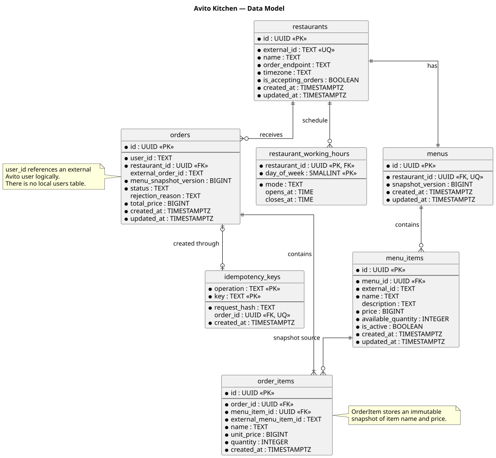
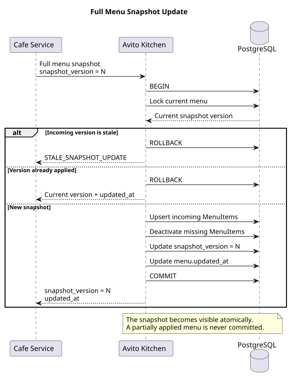

# Data Model

## 1. Назначение документа

Документ фиксирует логическую модель данных MVP **Avito Kitchen**, основные сущности, связи между ними, ограничения целостности и границы критичных транзакций.

Модель данных сформирована на основании ранее определённых:

* границ MVP;
* зон ответственности систем;
* бизнес-сценариев;
* API-контрактов;
* правил синхронизации меню;
* lifecycle заказа.

Основной СУБД проекта является PostgreSQL.

---

# 2. Основные принципы модели данных

При проектировании схемы используются следующие принципы.

## 2.1. База данных защищает простые инварианты

Ограничения, которые могут быть однозначно выражены средствами PostgreSQL, должны находиться не только в application layer, но и в схеме данных.

Используются:

* `PRIMARY KEY`;
* `FOREIGN KEY`;
* `UNIQUE`;
* `NOT NULL`;
* `CHECK`.

Например, база данных не должна позволять сохранить:

```text
quantity <= 0
price < 0
available_quantity < 0
```

---

## 2.2. Пользователь не является сущностью Avito Kitchen

Avito Kitchen не отвечает за lifecycle пользователя основной платформы Avito.

Поэтому отдельная таблица:

```text
users
```

не создаётся.

Заказ содержит внешний:

```text
user_id
```

который рассматривается как идентификатор пользователя основной платформы.

Логически существует связь:

```text
External User 1 ───── N Orders
```

однако она не представлена локальным `FOREIGN KEY`.

---

## 2.3. Исторические заказы не зависят от текущего меню

После создания заказа изменение:

* названия позиции;
* цены;
* описания;
* состава меню

не должно изменять историческое представление заказа.

Поэтому `OrderItem` содержит snapshot необходимых данных позиции на момент создания заказа.

---

## 2.4. Полная синхронизация меню применяется атомарно

Новый menu snapshot должен появляться в Avito Kitchen целиком.

Недопустимо наблюдаемое состояние:

```text
часть snapshot N
+
часть snapshot N+1
```

---

# 3. Основные сущности

В рамках MVP используются семь основных таблиц:

1. `restaurants`;
2. `restaurant_working_hours`;
3. `menus`;
4. `menu_items`;
5. `orders`;
6. `order_items`;
7. `idempotency_keys`.

---

# 4. Restaurant

Таблица:

```text
restaurants
```

представляет заведение внутри Avito Kitchen.

## Поля

| Поле                  | Тип           | Ограничения             | Назначение                                |
| --------------------- | ------------- | ----------------------- | ----------------------------------------- |
| `id`                  | `UUID`        | `PRIMARY KEY`           | Внутренний ID Avito Kitchen               |
| `external_id`         | `TEXT`        | `NOT NULL`, `UNIQUE`    | ID заведения в Cafe Service               |
| `name`                | `TEXT`        | `NOT NULL`              | Название                                  |
| `order_endpoint`      | `TEXT`        | `NOT NULL`              | Endpoint Cafe Service для заказов         |
| `timezone`            | `TEXT`        | `NOT NULL`              | Timezone рабочего расписания              |
| `is_accepting_orders` | `BOOLEAN`     | `NOT NULL DEFAULT true` | Может ли заведение принимать новые заказы |
| `created_at`          | `TIMESTAMPTZ` | `NOT NULL`              | Время создания                            |
| `updated_at`          | `TIMESTAMPTZ` | `NOT NULL`              | Последнее изменение                       |

## `external_id`

`external_id` позволяет связать представление заведения в Avito Kitchen с заведением в Cafe Service.

```text
Avito Kitchen:

id = <avito-restaurant-id>


Cafe Service:

external_id = <cafe-restaurant-id>
```

Для MVP предполагается интеграция с одним демонстрационным Cafe Service, поэтому глобальной уникальности `external_id` достаточно.

При развитии платформы идентификатор может быть дополнительно namespaced идентификатором партнёра.

---

# 5. Restaurant Working Hours

Таблица:

```text
restaurant_working_hours
```

описывает недельное расписание работы заведения.

## Поля

| Поле            | Тип        | Ограничения                       |
| --------------- | ---------- | --------------------------------- |
| `restaurant_id` | `UUID`     | FK → `restaurants.id`, `NOT NULL` |
| `day_of_week`   | `SMALLINT` | `NOT NULL`, `CHECK 1..7`          |
| `mode`          | `TEXT`     | `NOT NULL`                        |
| `opens_at`      | `TIME`     | nullable                          |
| `closes_at`     | `TIME`     | nullable                          |

Основной ключ:

```text
PRIMARY KEY (restaurant_id, day_of_week)
```

Таким образом, для одного заведения существует не более одного правила расписания на конкретный день недели.

---

# 6. Режим работы дня

`mode` принимает одно из трёх значений:

```text
CLOSED
INTERVAL
OPEN_24H
```

## INTERVAL

Обычный рабочий день.

Пример:

```text
mode = INTERVAL
opens_at = 09:00
closes_at = 22:00
```

Рабочее время интерпретируется как полуинтервал:

```text
[opens_at, closes_at)
```

То есть:

```text
09:00 <= current_time < 22:00
```

---

## OPEN_24H

Заведение работает круглосуточно.

```text
mode = OPEN_24H
opens_at = NULL
closes_at = NULL
```

Круглосуточная работа не кодируется специальными значениями:

```text
00:00 → 00:00
```

или:

```text
00:00 → 23:59
```

Бизнес-смысл хранится явно.

---

## CLOSED

Заведение не работает в этот день.

```text
mode = CLOSED
opens_at = NULL
closes_at = NULL
```

---

# 7. Ограничение расписания

Схема должна гарантировать согласованность `mode` и временных значений.

Логически используется ограничение:

```sql
CHECK (
    (
        mode = 'INTERVAL'
        AND opens_at IS NOT NULL
        AND closes_at IS NOT NULL
        AND opens_at < closes_at
    )
    OR
    (
        mode IN ('CLOSED', 'OPEN_24H')
        AND opens_at IS NULL
        AND closes_at IS NULL
    )
)
```

Также:

```sql
CHECK (mode IN ('CLOSED', 'INTERVAL', 'OPEN_24H'))
```

и:

```sql
CHECK (day_of_week BETWEEN 1 AND 7)
```

---

# 8. Ограничения расписания MVP

В рамках MVP поддерживается:

* один интервал работы в сутки;
* закрытый день;
* круглосуточная работа.

Не поддерживаются:

* несколько рабочих интервалов в один день;
* специальные праздничные расписания;
* интервалы, пересекающие полночь.

Например:

```text
18:00 → 03:00
```

не является допустимым расписанием MVP.

Это осознанное ограничение текущей реализации.

Application layer должен гарантировать наличие корректного расписания для всех необходимых дней недели.

---

# 9. Определение доступности заведения

Заведение доступно для оформления заказа, если одновременно выполняются условия:

```text
restaurant.is_accepting_orders = true
```

и текущий день имеет рабочий режим:

```text
OPEN_24H
```

либо:

```text
INTERVAL
AND
opens_at <= current_local_time < closes_at
```

Для определения локального времени используется:

```text
restaurant.timezone
```

Проверка выполняется:

* при выдаче списка доступных заведений;
* повторно непосредственно перед созданием заказа.

---

# 10. Menu

Таблица:

```text
menus
```

представляет актуальное меню заведения как отдельный агрегат.

## Поля

| Поле               | Тип           | Ограничения                            |
| ------------------ | ------------- | -------------------------------------- |
| `id`               | `UUID`        | `PRIMARY KEY`                          |
| `restaurant_id`    | `UUID`        | FK → restaurants, `NOT NULL`, `UNIQUE` |
| `snapshot_version` | `BIGINT`      | `NOT NULL`, `CHECK >= 0`               |
| `created_at`       | `TIMESTAMPTZ` | `NOT NULL`                             |
| `updated_at`       | `TIMESTAMPTZ` | `NOT NULL`                             |

Ограничение:

```text
UNIQUE (restaurant_id)
```

реализует связь:

```text
Restaurant 1 ───── 1 Menu
```

---

# 11. Menu Snapshot Version

`snapshot_version` представляет логическую версию каталожного состояния меню.

Версия изменяется при полной синхронизации:

```text
PUT menu snapshot
```

Например:

```text
42
 ↓
43
 ↓
44
```

Версия относится прежде всего к:

* составу меню;
* названию позиции;
* описанию;
* цене;
* существованию позиции.

Оперативное изменение количества через availability API не требует изменения `snapshot_version`.

Таким образом разделяются:

```text
catalog consistency
```

и:

```text
operational availability
```

---

# 12. Menu Item

Таблица:

```text
menu_items
```

представляет позицию меню.

## Поля

| Поле                 | Тип           | Ограничения              |
| -------------------- | ------------- | ------------------------ |
| `id`                 | `UUID`        | `PRIMARY KEY`            |
| `menu_id`            | `UUID`        | FK → menus, `NOT NULL`   |
| `external_id`        | `TEXT`        | `NOT NULL`               |
| `name`               | `TEXT`        | `NOT NULL`               |
| `description`        | `TEXT`        | nullable                 |
| `price`              | `BIGINT`      | `NOT NULL`, `CHECK >= 0` |
| `available_quantity` | `INTEGER`     | `NOT NULL`, `CHECK >= 0` |
| `is_active`          | `BOOLEAN`     | `NOT NULL DEFAULT true`  |
| `created_at`         | `TIMESTAMPTZ` | `NOT NULL`               |
| `updated_at`         | `TIMESTAMPTZ` | `NOT NULL`               |

Уникальность:

```text
UNIQUE (menu_id, external_id)
```

---

# 13. Деактивация Menu Item

При полной синхронизации позиция, отсутствующая в новом snapshot, перестаёт считаться частью актуального меню.

В MVP предпочтительно использовать:

```text
is_active = false
```

вместо обязательного физического удаления.

Это позволяет:

* сохранять исторические связи;
* избежать проблем с существующими заказами;
* при необходимости повторно активировать позицию.

Customer API возвращает только активные позиции.

---

# 14. Order

Таблица:

```text
orders
```

представляет заказ внутри Avito Kitchen.

## Поля

| Поле                    | Тип           | Ограничения                  |
| ----------------------- | ------------- | ---------------------------- |
| `id`                    | `UUID`        | `PRIMARY KEY`                |
| `user_id`               | `TEXT`        | `NOT NULL`                   |
| `restaurant_id`         | `UUID`        | FK → restaurants, `NOT NULL` |
| `external_order_id`     | `TEXT`        | nullable                     |
| `menu_snapshot_version` | `BIGINT`      | `NOT NULL`                   |
| `status`                | `TEXT`        | `NOT NULL`                   |
| `rejection_reason`      | `TEXT`        | nullable                     |
| `total_price`           | `BIGINT`      | `NOT NULL`, `CHECK >= 0`     |
| `created_at`            | `TIMESTAMPTZ` | `NOT NULL`                   |
| `updated_at`            | `TIMESTAMPTZ` | `NOT NULL`                   |

---

# 15. Order Status

В MVP поддерживаются:

```text
PROCESSING
ACCEPTED
REJECTED
```

Ограничение:

```sql
CHECK (
    status IN (
        'PROCESSING',
        'ACCEPTED',
        'REJECTED'
    )
)
```

`PROCESSING` означает, что заказ зарегистрирован в Avito Kitchen, но результат Cafe Service ещё не получен.

---

# 16. Rejection Reason

Для `REJECTED` могут использоваться бизнес-причины:

```text
OUT_OF_STOCK
ITEM_UNAVAILABLE
NOT_ACCEPTING_ORDERS
STALE_MENU_SNAPSHOT
```

Должен выполняться инвариант:

```text
status = REJECTED
→
rejection_reason IS NOT NULL
```

и:

```text
status != REJECTED
→
rejection_reason IS NULL
```

Пример ограничения:

```sql
CHECK (
    (
        status = 'REJECTED'
        AND rejection_reason IS NOT NULL
    )
    OR
    (
        status <> 'REJECTED'
        AND rejection_reason IS NULL
    )
)
```

---

# 17. Order Snapshot Version

При создании заказа сохраняется:

```text
menu_snapshot_version
```

который был актуален в момент его формирования.

Например:

```text
Order #123

menu_snapshot_version = 42
```

Даже если к моменту обработки Cafe Service текущая версия уже равна:

```text
43
```

Avito Kitchen точно знает, на основании какого snapshot был создан заказ.

---

# 18. Order Item

Таблица:

```text
order_items
```

представляет позицию внутри конкретного заказа.

Она является полноценной доменной сущностью, а не только технической many-to-many таблицей.

## Поля

| Поле                    | Тип           | Ограничения                 |
| ----------------------- | ------------- | --------------------------- |
| `id`                    | `UUID`        | `PRIMARY KEY`               |
| `order_id`              | `UUID`        | FK → orders, `NOT NULL`     |
| `menu_item_id`          | `UUID`        | FK → menu_items, `NOT NULL` |
| `external_menu_item_id` | `TEXT`        | `NOT NULL`                  |
| `name`                  | `TEXT`        | `NOT NULL`                  |
| `unit_price`            | `BIGINT`      | `NOT NULL`, `CHECK >= 0`    |
| `quantity`              | `INTEGER`     | `NOT NULL`, `CHECK > 0`     |
| `created_at`            | `TIMESTAMPTZ` | `NOT NULL`                  |

Уникальность:

```text
UNIQUE (order_id, menu_item_id)
```

---

# 19. Order Item как snapshot

При создании заказа необходимые данные копируются из актуального `MenuItem`.

Например:

```text
MenuItem:

name  = Маргарита
price = 70000
```

создаёт:

```text
OrderItem:

name       = Маргарита
unit_price = 70000
quantity   = 2
```

Если позже Cafe Service изменит:

```text
name  = Маргарита XL
price = 90000
```

исторический заказ продолжает отображать:

```text
Маргарита
70000
```

Таким образом изменение текущего меню не изменяет уже созданный заказ.

---

# 20. Связь Order и Menu Item

Концептуально между заказами и товарами существует связь many-to-many.

Однако модель представляется через отдельную сущность:

```text
Order 1 ───── N OrderItem

MenuItem 1 ───── N OrderItem
```

Это позволяет хранить дополнительные данные:

* количество;
* историческую цену;
* историческое название;
* внешний ID позиции.

---

# 21. Idempotency Key

Таблица:

```text
idempotency_keys
```

предотвращает создание нескольких заказов при повторной отправке одного пользовательского запроса.

## Поля

| Поле           | Тип           | Ограничения                     |
| -------------- | ------------- | ------------------------------- |
| `operation`    | `TEXT`        | PK part                         |
| `key`          | `TEXT`        | PK part                         |
| `request_hash` | `TEXT`        | `NOT NULL`                      |
| `order_id`     | `UUID`        | FK → orders, nullable, `UNIQUE` |
| `created_at`   | `TIMESTAMPTZ` | `NOT NULL`                      |

Основной ключ:

```text
PRIMARY KEY (operation, key)
```

Для текущего API:

```text
operation = CREATE_ORDER
```

---

# 22. Request Hash

`request_hash` позволяет обнаружить некорректное повторное использование одного ключа для разных запросов.

Первый запрос:

```text
Idempotency-Key = abc

Pizza × 2
```

Повтор:

```text
Idempotency-Key = abc

Pizza × 2
```

должен вернуть существующий результат.

Но:

```text
Idempotency-Key = abc

Burger × 10
```

является конфликтом.

В этом случае:

```text
stored_request_hash != new_request_hash
```

и API должен вернуть ошибку повторного использования ключа.

---

# 23. Основные связи

Модель содержит следующие связи.

```text
Restaurant 1 ───── 1 Menu

Restaurant 1 ───── N WorkingHours

Restaurant 1 ───── N Orders

Menu 1 ───── N MenuItems

Order 1 ───── N OrderItems

MenuItem 1 ───── N OrderItems

IdempotencyKey 1 ───── 0..1 Order
```

Дополнительно существует логическая внешняя связь:

```text
External User 1 ───── N Orders
```

---

# 24. ER Diagram




---

# 25. Транзакция полной синхронизации меню

Полная синхронизация должна выполняться одной database transaction.

Общий процесс:

```text
BEGIN

lock menu

validate snapshot version

upsert incoming items

deactivate missing items

update menu.snapshot_version
update menu.updated_at

COMMIT
```

При любой ошибке:

```text
ROLLBACK
```

---

# 26. Правила snapshot version

Пусть текущая версия Avito Kitchen:

```text
42
```

Cafe Service присылает:

```text
43
```

Snapshot применяется.

Если Cafe Service сразу присылает:

```text
45
```

snapshot также может быть применён.

Поскольку передаётся полное состояние меню, промежуточные версии:

```text
43
44
```

не требуются для восстановления состояния.

---

Если текущая версия:

```text
45
```

а Cafe Service присылает:

```text
44
```

обновление является устаревшим и не применяется.

---

Если Cafe Service повторно присылает:

```text
45
```

операция рассматривается как retry уже применённого snapshot.

Она должна быть безопасна и не приводить к повторным побочным эффектам.

---

# 27. Menu Snapshot Transaction Diagram


---

# 28. Транзакция создания заказа

Создание заказа и связанных данных выполняется атомарно.

Общий процесс:

```text
BEGIN

register idempotency key

validate restaurant

read current menu version

read requested menu items

validate expected prices
validate availability
validate quantities

calculate total price

insert order
status = PROCESSING

insert order item snapshots

link idempotency key with order

COMMIT
```

Пользователь получает успешный ответ только после `COMMIT`.

---

# 29. Что создаётся атомарно

В результате транзакции одновременно должны существовать:

```text
Order

+

OrderItems

+

total_price

+

menu_snapshot_version

+

idempotency binding
```

Не допускается частичное состояние, например:

```text
Order существует,
но часть OrderItems отсутствует.
```

---

# 30. Внешний HTTP-вызов не входит в транзакцию

Вызов Cafe Service не должен выполняться внутри database transaction.

Недопустимая схема:

```text
BEGIN

create order

HTTP → Cafe Service

wait...

update order

COMMIT
```

Внешняя сеть может быть медленной или недоступной, поэтому database transaction не должна удерживаться во время HTTP-вызова.

Используется разделение:

```text
TX #1

create Order
status = PROCESSING

COMMIT
```

затем:

```text
Background Worker
        ↓
Cafe Service
```

после получения результата:

```text
TX #2

PROCESSING
    ↓
ACCEPTED / REJECTED

COMMIT
```

---

# 31. Create Order Transaction Diagram



---

# 32. Background Processing

Фоновый worker обрабатывает заказы со статусом:

```text
PROCESSING
```

Заказ сохраняется до попытки взаимодействия с Cafe Service.

Поэтому завершение процесса Avito Kitchen после пользовательского запроса не приводит к потере заказа.

Передача заказа Cafe Service должна быть идемпотентной по:

```text
avito_order_id
```

Повторная передача того же заказа не должна создавать второй заказ в Cafe Service.

---

# 33. Индексы

Индексы добавляются только под существующие ограничения и query patterns.

## Restaurants

```text
PRIMARY KEY (id)

UNIQUE (external_id)
```

---

## Restaurant Working Hours

```text
PRIMARY KEY (restaurant_id, day_of_week)
```

---

## Menus

```text
PRIMARY KEY (id)

UNIQUE (restaurant_id)
```

---

## Menu Items

```text
PRIMARY KEY (id)

UNIQUE (menu_id, external_id)
```

Для получения актуального меню может использоваться partial index:

```sql
CREATE INDEX idx_menu_items_active
ON menu_items(menu_id)
WHERE is_active = true;
```

---

## Orders

```text
PRIMARY KEY (id)
```

Для background worker:

```sql
CREATE INDEX idx_orders_processing
ON orders(created_at)
WHERE status = 'PROCESSING';
```

---

## Order Items

```text
UNIQUE (order_id, menu_item_id)
```

---

## Idempotency Keys

```text
PRIMARY KEY (operation, key)
```

---

# 34. Основные инварианты

После проектирования модели фиксируются следующие правила.

```text
price >= 0
```

```text
available_quantity >= 0
```

```text
order_item.quantity > 0
```

```text
one current menu per restaurant
```

```text
one schedule rule per restaurant and weekday
```

```text
one Cafe item identifier per menu
```

```text
one MenuItem occurrence per Order
```

```text
REJECTED order requires rejection_reason
```

```text
non-REJECTED order must not contain rejection_reason
```

```text
OPEN_24H and CLOSED have no opens_at/closes_at
```

```text
INTERVAL requires opens_at < closes_at
```

```text
menu snapshot is applied atomically
```

```text
order, order items and idempotency binding
are created atomically
```

---

# 35. Осознанные ограничения MVP

На данном этапе намеренно не реализуются:

* локальная таблица пользователей;
* несколько меню одного ресторана;
* категории меню;
* несколько рабочих интервалов одного дня;
* рабочие интервалы через полночь;
* праздничные расписания;
* история версий меню;
* резервирование товара;
* резервирование цены;
* платежи;
* доставка;
* история переходов статусов заказа.

Эти возможности могут быть добавлены при появлении соответствующих бизнес-требований.

